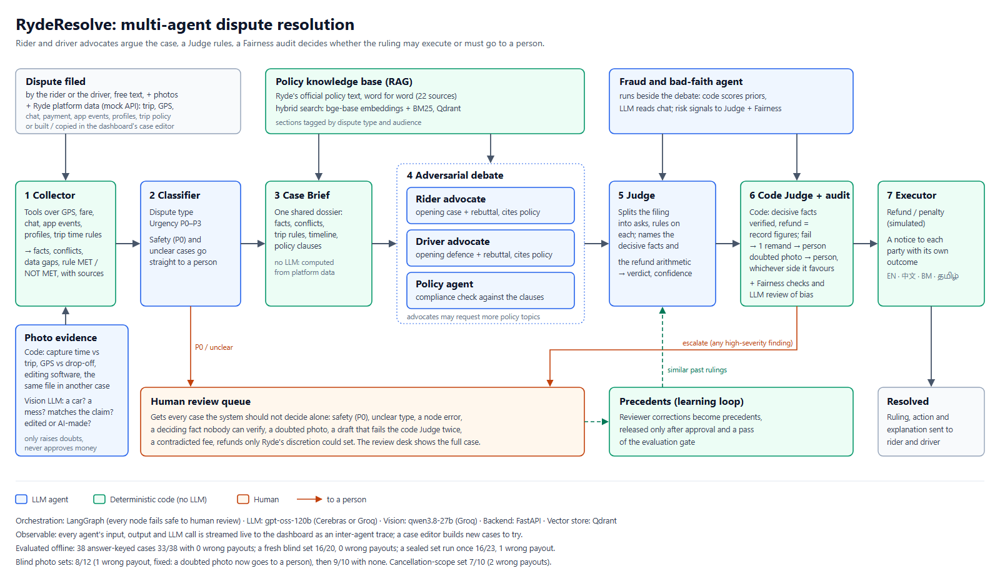

# RydeResolve-Agent

## Overview

RydeResolve-Agent settles ride disputes on **Ryde**, Singapore's first real-time carpooling
platform, using a pipeline of cooperating agents. A Rider Advocate and a Driver Advocate each build
their side's case from platform evidence and Ryde's policy, then rebut each other. A Judge
rules on every ask under the organisers' **Ryde Dispute Resolution Policy v2.1**, with a confidence
score and reasons. Photos are checked by code (capture time,
place, editing, reuse) and by a vision model. Code checks (including v2.1's routing rules) and a
Fairness review decide whether the ruling is executed automatically or sent to a person. Every step is traced and
visible live.

**Update (2026-10-30):** harassment and unwanted advances now always reach a person (6/6 and 6/6 on two
new blind sets, including complaints with no chat), and a driver who wins a money claim is now paid the
amount instead of having it written as text. What changed, why, and the results:
[docs/UPDATE_2026-10-30.md](docs/UPDATE_2026-10-30.md).

**Status (2026-10-16):** submitted; one known gap is open (data-problem records, D59, below). Since D50 the system reads the organisers' sample
format (DISP-001..003: fare breakdown, surge log, recommended route, traffic incidents) and rules
under their Ryde Dispute Resolution Policy v2.1, whose routing rules (safety, dispute value above
S$50, fraud flags, contested damage) are enforced in code. Evaluated on Cerebras `gpt-oss-120b`, one
run per case:

| Under Policy v2.1 (D50) | Correct | Wrong payouts |
|---|---|---|
| Organisers' samples DISP-001, DISP-002, DISP-003 | **3/3** | 0 |
| Blind set V2 (12 cases written from v2.1 by another model) | 10/12 | 0 |
| Blind set OF (30 cases in the organisers' full format, every dispute type) | 25/30 | 2 found, fixed and re-run; 1 disputed key (D50) |
| Regression: mock + held-out + fresh2 (52 earlier cases, keys re-checked against v2.1) | **44/52** | **0** |

On the regression, 28 of the 36 disputes v2.1 lets AI decide (78%) closed with no human, in about
89 seconds each; every miss was a case handed to a person. Seven of the 52 runs had an advocate turn
that failed (provider busy or a reply cut at the token cap). After D53-D54 (retry once, else a person)
those 7 were re-run: 3 of the 4 that were misses are now decided with the right verdict, but one of
them (F2-15) paid the driver S$2.80 of the key's S$8.80, a wrong payout; the 3 that were right stay
right (D54). 44/52 stays the measured
figure; the other 45 cases were not re-run. This is evaluation accuracy, not an
automatic resolution rate: a case sent to a person counts as a miss whenever the answer key says the
system could have decided it.

**Re-run on the submitted code (16 Oct, D55-D59):** the same 52 cases, one run each, gave 44/52 ->
**45/52** verdicts (rate-based refunds such as per-minute stop credits now pass the code checks,
D57-D58), but **5 automatic rulings were wrong**: F2-12, F2-16 and F2-17 (a record with a logged data
problem; they must go to a person), RD-002 (S$3.10 refunded, key: no refund) and F2-15 (S$2.80 of
S$8.80, as in D54). A prompt line added that day made the Judge leave the questioned record out of its
facts; it is removed (D59), and on re-run F2-16 and RD-002 are right again. Running F2-12 and F2-17
twice each on the code from before that day shows the same slip once in two: the Code Judge catches a
questioned record only when the Judge lists it among its facts. So "no wrong payout" above held for
one run per case, not reliably. The next fix is a code check on the questioned record itself, not on
what the Judge lists (D59).

Before v2.1 (D38-D48, Help Centre policy): 38 labelled cases 33/38 with 0 wrong payouts; blind sets
16/20 and 13/20; a sealed set run once 16/23; photo sets 8/12 and 9/10; a cancellation-scope set
7/10. Every miss and wrong payout, and the fix it led to, is in
[docs/08_DESIGN_DECISIONS.md](docs/08_DESIGN_DECISIONS.md).

**Live demo (2026-10-15)** on a Tencent Lighthouse server in Singapore:

| Page | Link | Access code |
|---|---|---|
| Demo dashboard (run a dispute, watch the agents) | http://43.134.17.192 | demo code |
| Administrator review desk (escalated cases, human rulings, precedents) | http://43.134.17.192/review.html | admin code |

Access codes are given to judges and are not published here. On the dashboard, the organisers' samples DISP-001..003 are in the case list,
recorded runs can be replayed under "Saved runs",
and "+ New case" / "Copy & edit" build a new case (trip, profiles, chat, rules, photos) to run.
Demo video (7:49): [docs/demo/demo_video.mp4](docs/demo/demo_video.mp4).
Walkthrough: [docs/DEMO_SCRIPT.md](docs/DEMO_SCRIPT.md). Deployment: [deploy/README.md](deploy/README.md).

## Background

### About Ryde

[Ryde Technologies Pte. Ltd.](https://www.rydesharing.com) is a Singapore-based mobility platform offering:

| Service | Description |
|--------|-------------|
| Ride-hailing | Private car services with instant & advance booking |
| Delivery | Point-to-point on-demand delivery (RydeSEND) |
| Carpooling | Shared rides, eco-friendly travel — Ryde's flagship differentiator |

**Key business differentiators**:
- **0% commission for drivers** (vs Grab/Gojek)
- **Ryde+ subscription** for passengers (unlimited cashback, priority matching)
- Corporate & merchant solutions

### Problem

As a multi-sided platform connecting passengers, drivers, merchants, and corporate clients, Ryde faces significant dispute volume across fare, cancellation, service quality, delivery, driver rights, and accident liability categories. Current manual customer service is slow, inconsistent, and costly.

## Architecture



Vector source: [`docs/architecture.svg`](docs/architecture.svg).

### Core Agents

| Agent | Role |
|-------|------|
| **Collector** | Deterministic tools over platform data (GPS, fare, chat, app events, profiles; the organisers' fare breakdown, surge log, recommended route and traffic incidents) produce facts, conflicts and data gaps, each with its source; v2.1 checks: surge rose without notice (s3.3), excess over the recommended route and its tolerance (s1.3), incidents on that route during the trip (s1.4), a message AND a call before a no-show cancel (s2.3); rule checks measure the trip's time rules and report MET / NOT MET; photo checks read each photo's capture time and GPS against the trip, editing software, and the same file in another case |
| **ImageAnalyst** | A vision model (`qwen/qwen3.8-27b` on Groq) says what each photo shows: a car, a mess, whether it matches the claim, signs of editing or generation. It can only raise doubts, never approve money |
| **ChatTone** | Labels each chat message's tone and key moments (agree, object, apology, promise) by code; a model re-checks only doubtful messages (possible sarcasm, a negated insult, a language the word lists barely cover). For the reviewer and the notice wording only, never an agent input |
| **Classifier** | Dispute type and urgency (P0-P3); safety and unclear cases go straight to a person |
| **Case Brief** | One shared dossier (no LLM): facts, conflicts, the trip's rules, timeline and retrieved policy clauses |
| **Rider / Driver advocates** | Each builds its side's case from the brief and cites policy, then rebuts the other |
| **Fraud** | Deterministic risk signals and evidence-grounded chat labels; threats route separately to safety review |
| **Policy** | Compliance check of both cases against the retrieved official Ryde policy (RAG) |
| **Judge** | Splits the filing into asks, rules on each with amounts from specific rules, gives confidence and reasons; names the facts its ruling turns on and the refund arithmetic; sees approved precedents |
| **Code Judge** | Code, not a model: every decisive fact must be verified on a record nothing contradicts, and a refund must be plain arithmetic on record figures; a route refund is capped at the excess distance fare; an upheld driver claim must state its award; no payment rests on a doubted photo; a failing draft goes back to the Judge once, then to a person |
| **Policy gate** | Policy v2.1's routing in code: safety incidents (s5.2, from words or driving-safety events), dispute value above S$50 or S$10-50 below 0.80 confidence (s6.1), a fraud flag below 0.95 confidence (s6.3), a rider contesting damage (s4.4) go to a person |
| **Fairness** | Code checks (real citations, GPS gaps, fee basis, refund basis) plus an LLM grounding/bias review; any high-severity finding sends the case to a person; a ruling whose reasons lean on a party's manner gets a note for the reviewer |
| **Executor** | Simulated refund / penalty and a notice to each party with its own outcome (EN/ZH/MS/TA); an upset party's notice opens with one acknowledging line |

### Key Innovations

1. **Adversarial debate on shared facts.** Both advocates argue from the same Case Brief (facts,
   conflicts and data gaps found by deterministic tools), then rebut each other. `MAX_DEBATE_ROUNDS`
   sets the number of rounds (default 1).
2. **Rulings per ask, amounts from rules.** The Judge splits a filing into its separate asks and
   takes every amount from a specific policy rule applied to a specific figure.
3. **Policy anchoring with verified citations.** The sections of Ryde Dispute Resolution Policy
   v2.1 a case needs are given to every agent in full and cited by section; Help Centre clauses come
   from retrieval. A ruling may only cite what it was given; invalid citations are caught in code.
4. **Safe by default.** Safety cases, missing data, contradicted payouts, discretionary refunds and
   high-severity fairness findings go to a person instead of being executed.
5. **Code checks the Judge.** The model does not check itself: code verifies the facts a ruling
   turns on and the refund arithmetic, and measures time rules itself. On the 38-case and fresh sets
   no run paid out on a wrong ruling after this check; the sealed set found one (D41).
6. **Photos checked twice.** Code reads what a photo's file says (when, where, edited, reused);
   a vision model reads what it shows. Either can only raise a doubt, and a doubted photo is
   always a person's decision.
7. **Learning with a human in the loop.** Reviewers approve or correct rulings, and a correction
   becomes a precedent the Judge can see only after an evaluation shows it does no harm. The Judge
   sees at most three: same dispute type, decided under the policy now in force, one per principle,
   most similar facts first; a ruling can only claim a precedent it was shown. Risk flags count only
   after a person confirms them.
8. **Full audit trail.** A live trace of every agent step and LLM call, rulings stored in a database,
   and an append-only, hash-chained audit log (`GET /api/audit/verify`).

## Tech Stack

| Layer | Technology |
|-------|-----------|
| Orchestration | LangGraph state graph (`src/core/workflow.py`) |
| LLM | `LLM_PROVIDER`: Groq or Cerebras (`gpt-oss-120b`), Google Gemini, Tencent Hunyuan (TokenHub), or any OpenAI-compatible endpoint (`openai_compatible`, e.g. a self-hosted open model). `JUDGE_LLM_PROVIDER` gives the Judge its own model. `LLM_FALLBACK_PROVIDERS` tries backups in order |
| Vision | `qwen/qwen3.8-27b` on Groq for photo descriptions; Pillow reads and writes photo EXIF |
| Governing policy | Ryde Dispute Resolution Policy v2.1 (`data/policies/governing/`), sections selected per case in code (`src/core/governing_policy.py`) |
| Policy retrieval | Qdrant Cloud hybrid search (dense `bge-base-en-v1.5` + BM25 via fastembed, RRF fusion; collection `ryde_policies_official`); local ChromaDB as an alternative |
| Tencent Cloud | ADP (Agent Development Platform) policy assistant on Hunyuan hy3, built over the same official policy files (`scripts/adp/`) |
| Records | SQLAlchemy store: SQLite locally, Postgres (Supabase) via `STORE_URL` / `DATABASE_URL` |
| Backend | Python + FastAPI, live trace streamed over server-sent events |
| Frontend | Single-page dashboard (`frontend/index.html`, plain JS): pick or build a case (`case_editor.js`), watch the agents, read the ruling and both notices; review desk (`review.html`) |
| Tests | pytest (offline, no real model calls) |
| Containers | Dockerfile + docker-compose |

## Dispute Categories

Covered end to end with labelled test cases: **fare disputes**, **route deviation**, **no-show
charges**, **cancellation and refunds**, **cleaning fees**, **service quality** (conduct
complaints) and **driver rights**. Safety incidents are classified P0 and always go to a person.

## Quick Start

```bash
python -m pip install -r requirements.txt
# create .env with the variables below
python -m uvicorn src.api.main:app --host 127.0.0.1 --port 8000
# Open http://127.0.0.1:8000 in your browser
```

On Windows, run `./Start-Ryde.ps1` in PowerShell to check dependencies, open the dashboard,
and start the API. Use `./Start-Ryde.ps1 -Port 8001` if the old server occupies port 8000.
The terminal must remain open. Do not use CMD's `start "" ...` syntax in PowerShell.

The dashboard and API share an origin. `/api/health` reports process liveness;
`/api/readiness` separately checks model-key configuration, record connectivity and policy
collection/model dimensions. It does not verify live quota or model quality.

An optional untracked `.env.local` overrides `.env` for this machine (explicit process
variables take precedence). For an isolated local demo with the existing official Qdrant index:

```dotenv
STORE_URL=sqlite:///data/ryde_resolve.local.db
QDRANT_COLLECTION=ryde_policies_official
QDRANT_DENSE_MODEL=BAAI/bge-base-en-v1.5
POLICIES_DIR=data/policies/official
MAX_DEBATE_ROUNDS=1
```

This local record database is separate from the shared store; it does not import shared
history. Set STORE_URL explicitly to reconnect to the shared store after connectivity is fixed.
The local Groq smoke run exceeded this account's 8,000-token single-request capacity with
three debate rounds (8,927 requested). The local profile uses the project default of one
round; this is a demo configuration change, not a new full-evaluation accuracy claim.
Only select an existing Qdrant collection indexed with the same embedding model; do not rebuild
any shared collection to start the demo.

Before remote access, configure distinct `API_DEMO_KEY` and `API_ADMIN_KEY` secrets and HTTPS.
With keys configured, the dashboard asks for an access code and keeps it only in memory.
Demo access can run cases; uploads, deletions, reviews, precedents, flags and audit/history
administration require the admin key. Audit actor names come from the authenticated role.
Without keys, API access is limited to loopback clients and hosts, with origin checks.
The API permits one dispute run at a time and cancels further work after a stream disconnect;
an already-sent provider request can still complete and be billed.

The shared `ryde_policies_official` collection is read-only through the upload/delete API
unless `ALLOW_POLICY_MUTATIONS=1` is explicitly set. Use a separate collection for uploaded
documents; evidence files never enter the policy index. Uploads accept at most 5 files,
10 MB per file, with generated storage names and bounded multipart request bodies.
The container keeps policy/case files in the image and mounts only writable data directories.
If using SQLite in Docker, set `STORE_URL=sqlite:///data/records/ryde_resolve.db` to use its
record volume. The default compose store is Postgres; a clean container build is still required.

Main `.env` variables:

| Variable | Purpose |
|----------|---------|
| `LLM_PROVIDER` | `groq`, `cerebras`, `gemini` or `hunyuan` |
| `LLM_FALLBACK_PROVIDERS` | Backup providers tried in order, e.g. `cerebras,gemini` |
| `GROQ_API_KEY`, `CEREBRAS_API_KEY`, `LLM_API_KEY` (Gemini), `HUNYUAN_API_KEY` | Provider keys |
| `LLM_SPEND_CAP_USD` | Per-process spend cap for the paid Cerebras credit (default 1.00) |
| `VECTOR_BACKEND`, `QDRANT_URL`, `QDRANT_API_KEY`, `QDRANT_COLLECTION`, `QDRANT_DENSE_MODEL`, `POLICIES_DIR` | Policy index (`qdrant` or `chroma`); the team uses `ryde_policies_official`, `BAAI/bge-base-en-v1.5`, `data/policies/official` |
| `STORE_URL` / `DATABASE_URL` | Records database (default: local SQLite) |
| `MAX_DEBATE_ROUNDS` | Debate rounds (default 1) |

## Evaluation

```bash
LLM_PROVIDER=cerebras python scripts/eval.py --yes        # all labelled cases
python scripts/eval.py --cases FD-002,NS-001 --repeat 3     # chosen cases, stability check
python scripts/eval.py --resume data/eval/<run>             # continue a stopped run
python -m pytest -q                                         # offline unit tests
```

Each run writes `data/eval/<timestamp>/report.html`, `results.csv` and one trace per case. Evals
never use fallback providers, so a run never mixes models. Results under Policy v2.1 are in the
status table above (D50); earlier results (D38-D48, before v2.1):

| Set | Cases | Correct | Wrong payouts | Run |
|-----|-------|---------|---------------|-----|
| Dev + held-out (answer keys written before the fixes) | 38 | 33 | 0 | 20261012-115556 |
| Fresh set written blind by a Claude Sonnet subagent | 20 | 16 | 0 | 20261012-155745-fresh |
| Sealed set (Gemini + qwen cases, run once, never used for a fix) | 23 | 16 | 1 (S$8.00) | 20261012-174317-sealed |
| Fresh set 2, written blind after the D42 fix | 20 | 13 | 1 (S$8.00) | 20261012-213702-fresh2 |
| Photo set IM (cleaning fees, stamped photos), blind | 12 | 8 | 1 (S$100 refund on a doubted photo; fixed in D47) | 20261014-113148-images |
| Photo set PS (mostly rider disputes of a fee charged on a photo), blind, after D47 | 10 | 9 | 0 (one award amount left empty) | 20261014-132901-photo-side |
| Cancellation-scope set CS, blind, after D48 | 10 | 7 | 2 (S$5.50, S$8.00) | 20261014-140420-cancel-scope |

On the sealed set two runs hit provider errors (HTTP 429) and were re-run once; the raw first pass
was 14/23. The misses, including the wrong payout and why it got through, are in
`docs/08_DESIGN_DECISIONS.md` (D41, D42). All results are without precedents: the precedent
store was empty in every evaluated run; when precedents should reach the Judge is designed in D43.
Every change, its measured effect and the rejected
alternatives are in `docs/06_EVAL_PLAN.md` and `docs/08_DESIGN_DECISIONS.md`.

## Responsible AI and data protection

What the system does today:
- **Each agent sees only what its role needs.** The advocates never see fraud scores or a party's
  dispute history (only the Judge and Fairness do), so they argue the case, not the person. Every
  prompt forbids inferring protected characteristics (race, gender, religion) and repeating personal
  data the ruling does not need.
- **Both parties get an explanation they can read.** Each party's notice is built by code from the
  ruling's fields only, so it cannot state an amount the ruling did not make. The dashboard shows it
  in English, Chinese, Malay or Tamil (`POST /api/notices`, no model call).
- **Tone is read, never weighed.** Code labels each chat message's tone (calm, frustrated, angry,
  abusive, distress) and key moments (agree, object, apology, promise), citing the message; a model
  re-checks only the messages a word list may misread (sarcasm, negation, other languages), and its
  answer is checked. Reviewers see the tags in the case timeline and on the review desk ("AI checked"
  where the model relabelled), and an upset party's notice opens with one acknowledging line. The
  advocates and the Judge never get the labels, and Fairness notes a ruling on a fare, fee or refund
  whose reasons lean on a party's manner (`src/agents/chat_signals.py`, D52, D52b). On 34 test
  messages: code alone 28/34, code plus model 29/34 with every upset message caught.
- **A person decides what AI should not.** Safety reports, disputes above S$50, contested damage,
  doubted photos, low confidence and failed checks go to a person; the escalated party is told no
  money moves until a specialist reviews the case.
- **Accountability.** Every ruling, review and precedent change is written to an append-only,
  hash-chained audit log, and every prompt and response is kept in the case trace.
- **Access.** Two access codes: the demo code cannot read rulings, precedents, people or the audit log.
- **Demo data only.** All cases are synthetic or the organisers' samples; no real rider or driver
  data is used.

What a real deployment under Singapore's PDPA would still need (not built in the hackathon):
- Tell riders and drivers that an AI system takes part in deciding disputes, and how to ask for a person.
- Mask names, phone numbers and plate numbers before any call to an external model, or keep the
  model in-house (self-hosted, below).
- A retention schedule: delete chats, photos and GPS traces once the dispute and its appeal window
  close; keep the ruling and its audit entry.
- Encryption at rest, and model providers under a data-processing agreement with no training on the data.
- An "ask a person to review" link in every notice, routed to the review desk.

## Scale and cost beyond the demo

The live site is a demo: one Tencent Cloud Lighthouse server in Singapore (2 vCPU, 2 GB), SQLite,
and one model (`gpt-oss-120b` on Cerebras) on low-tier API keys with daily caps. A real deployment
would change three things:

- **Servers.** More or larger Tencent Cloud instances behind a load balancer, Postgres (the store
  already takes `STORE_URL`) and a job queue. A case spends most of its ~89 seconds waiting for the
  model, so throughput is set by the model provider's rate limits, not by CPU: one async worker runs
  many cases at once.
- **A stronger Judge, cheap everything else.** `JUDGE_LLM_PROVIDER` runs the one call that decides
  money on its own model; every other agent stays on `gpt-oss-120b`. Today it accepts the built-in
  providers and any OpenAI-compatible endpoint; a Claude Judge would add an adapter on Anthropic's SDK.
- **Self-hosting.** `LLM_PROVIDER=openai_compatible` (`OPENAI_COMPAT_BASE_URL`, `OPENAI_COMPAT_MODEL`)
  points any agent at an open model such as DeepSeek served with vLLM or Ollama on a company GPU
  server: no per-token fee, and the data never leaves the company. Large DeepSeek models need a
  multi-GPU server; smaller ones fit on one or two GPUs.

Model cost, from the token use measured on the demo runs (Judge about 9,000 tokens in and 1,600
out; the six other calls together about 24,000 in and 6,000 out) at list prices in USD. The Judge
range allows 1,600-4,000 output tokens for reasoning; a remanded draft adds one more Judge call;
photo cases add one vision call per photo; servers and storage are extra. The daily volumes are
illustrations, not Ryde figures:

| Setup | Per dispute | 1,000 a day, per month | 5,000 a day, per month |
|---|---|---|---|
| Everything on `gpt-oss-120b` (Cerebras, $0.35 / $0.75 per million tokens), as today | ~$0.017 | ~$520 | ~$2,600 |
| Judge on Claude Sonnet 5.5 ($2 / $10), the rest on `gpt-oss-120b` | ~$0.05-0.07 | ~$1,400-2,100 | ~$7,000-10,700 |
| Judge on Claude Opus 5.5 ($4 / $20), the rest on `gpt-oss-120b` | ~$0.08-0.13 | ~$2,400-3,900 | ~$12,000-19,000 |
| Open model (e.g. DeepSeek) on the company's own GPU server | no per-token fee | cost of the server | cost of the server |

Every accuracy figure in this README is for `gpt-oss-120b`. Before any model change goes live, the
same evaluation sets are run on it, and the change ships only if no safety or payout metric gets worse.

## Project Structure

```
RydeResolve-Agent/
├── src/
│   ├── agents/        # collector (+ collector_tools, photo_checks), image_analyst, classifier,
│   │                  # case_brief, passenger, driver, policy, arbitrator (Judge), code_judge,
│   │                  # fraud, fairness, executor, chat_signals (chat tone), safety, policy_gates
│   ├── core/          # workflow (LangGraph), debate, llm_client, trace, policy_refs, confidence
│   ├── rag/           # indexer, retriever, Qdrant hybrid search, policy topics, precedents
│   ├── store/         # records DB, audit chain, feedback/precedents, rider/driver history
│   ├── integrations/  # simulated Ryde platform API (integration contract)
│   ├── api/           # FastAPI service, case editor upload (custom_cases)
│   └── config.py
├── frontend/          # dashboard: index.html, dispute.js, case_editor.js, review desk
├── data/
│   ├── policies/governing/  # Ryde Dispute Resolution Policy v2.1 (the organisers' policy)
│   ├── policies/official/   # verbatim Ryde Help Centre texts (retrieval source)
│   ├── Dispute_format/      # the organisers' samples DISP-001..003
│   ├── mock_disputes/       # demo disputes with platform data
│   ├── eval_cases/          # held-out, sealed, fresh, photo, fraud, policy_v21, official_format
│   ├── evidence_samples/    # photo library (SOURCES.json) and the stamped case photos
│   └── eval_answer_keys.json
├── scripts/           # eval, index_policies, adp/ (Tencent ADP), migrate_store, seed_people, ...
├── tests/             # pytest suite
├── docs/              # requirements, development log, eval plan, design decisions, architecture
└── proof of usage of codebuddy/   # CodeBuddy development screenshots
```

## Documentation

| Document | Contents |
|----------|----------|
| [docs/01_PROJECT_REQUIREMENTS.md](docs/01_PROJECT_REQUIREMENTS.md) | Competition brief and what it requires |
| [docs/03_DEVELOPMENT_LOG.md](docs/03_DEVELOPMENT_LOG.md) | Dated development log and current handoff |
| [docs/06_EVAL_PLAN.md](docs/06_EVAL_PLAN.md) | How the architecture is evaluated |
| [docs/UPDATE_2026-10-30.md](docs/UPDATE_2026-10-30.md) | What changed after the submission, why, and the blind-test results |
| [docs/08_DESIGN_DECISIONS.md](docs/08_DESIGN_DECISIONS.md) | Every design change with its measured effect, and the rejected ones (D1–D68) |
| [docs/09_FRAUD_AGENT_DESIGN.md](docs/09_FRAUD_AGENT_DESIGN.md) | Fraud and bad-faith detection design |
| [docs/DEMO_SCRIPT.md](docs/DEMO_SCRIPT.md) | 8-minute demo walkthrough: five recorded runs and a live case-editor run |
| [docs/PITCH_5MIN.md](docs/PITCH_5MIN.md) | Demo Day script: three replayed cases, results and cost in five minutes, likely questions |
| [deploy/README.md](deploy/README.md) | Running the service on a Linux server (systemd + Caddy) |

## License

MIT
